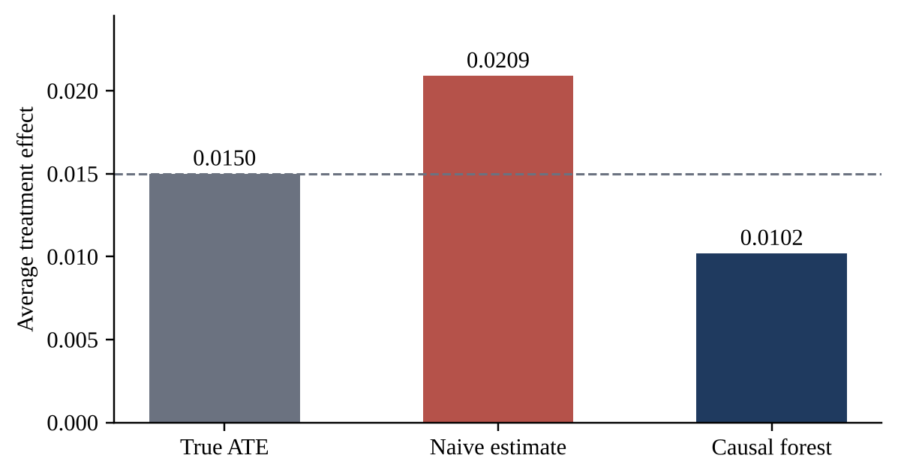
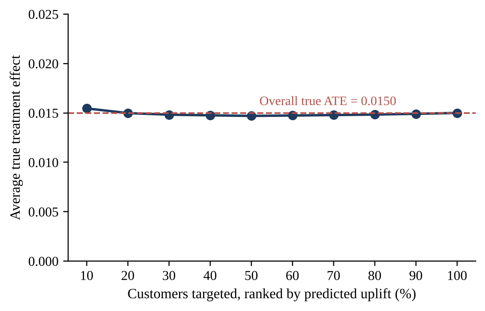

# Causal Machine Learning for Estimating the Effect of Discounts on Customer Purchases

M.Sc. Statistics and Computing project by **Anshu Yadav**, DST-Centre for Interdisciplinary Mathematical Sciences, Banaras Hindu University.

Predictive models say who is *likely to buy*. They do not say whether a discount *causes* the purchase. This project estimates the causal effect of a discount on the probability of purchase in a simulated customer dataset where the true effect is known, and tests how well a naive comparison, a causal forest and an uplift model recover it.

The full write-up is in [`report/`](report/) (Word and PDF).

## Main findings

| Quantity | Value |
|---|---|
| True ATE (simulated) | 0.0150 (1.50 percentage points) |
| Naive ATE (treated minus control) | 0.0209, an overstatement of 39.10% |
| Causal forest ATE | 0.0102 (absolute error 0.0048, relative error 32.09%) |
| Causal forest CATE: RMSE / correlation with true effects | 0.0201 / 0.1755 |
| Two-model uplift: RMSE / correlation with true effects | 0.0413 / −0.0591 |
| Bootstrap mean ATE, 95% CI (500 resamples) | 0.0205, [0.0049, 0.0359] |
| Welch *t*-test | *t* = 2.5423, *p* = 0.011029 |
| Placebo test: mean, 95% interval | 0.0001, [−0.0161, 0.0172] |
| Naive ATE across 10 seeds: mean (SD) | 0.0260 (0.0081), above the true value in 9 of 10 seeds |

What the results show:

- **Confounding biases the naive estimate.** Customers with higher average order value are more likely to receive a discount and also buy more often, so the raw comparison overstates the effect. Across ten random seeds the overstatement averages about 73%.
- **The causal forest improves the average effect but not individual effects.** Its ATE is closer to the truth, but its individual estimates are noisy (estimated range −0.075 to 0.100 against a true range of 0.006 to 0.025).
- **The uplift ranking did not work in this experiment.** The true average effect is about 0.015 in every targeted group (0.0155 in the top 10%), so the ranking does not find customers who respond more.
- **The revenue gain from uplift targeting is an order-value effect.** The top 30% by predicted uplift earn more incremental revenue than a random 30% (15,368.59 against 12,671.77) but give slightly *fewer* incremental purchases (44.48 against 45.30), because they spend more per order.
- **The ROI of 900% is mechanical.** Discount cost is defined as 10% of incremental revenue, so every strategy has the same ROI.

<p align="center">
  
  
</p>

## How the data are simulated

10,000 customers with four characteristics: `previous_purchases` (0 to 49), `avg_order_value` (10 to 500), `days_since_last_purchase` (1 to 364) and `email_clicked` (about 35% click).

- **Treatment (discount):** probability `0.20 + 0.50 × avg_order_value / 500`, limited to [0.05, 0.90]. Average order value is therefore the confounder.
- **Baseline purchase probability:** `0.10 + 0.002 × previous_purchases + 0.00015 × avg_order_value + 0.05 × email_clicked`.
- **True individual effect:** `0.005 + 0.00015 × previous_purchases + 0.000015 × avg_order_value + 0.002 × email_clicked`, rescaled to a mean of 0.015 (range 0.0059 to 0.0248).
- **Outcome:** drawn with probability `baseline` without a discount and `baseline + effect` with one.

The random seed is 42. `days_since_last_purchase` does not enter the simulation.

## Repository structure

```
.
├── src/                          # analysis, one script per step
│   ├── 01_generate_data.py       # synthetic data with confounded treatment
│   ├── 02_naive_estimation.py    # naive difference in purchase rates
│   ├── 03_causal_forest.py       # EconML CausalForestDML
│   ├── 04_uplift_modeling.py     # two-model uplift, 5-fold cross-fitting, targeting curve
│   ├── 05_statistical_validation.py  # bootstrap CI, Welch t-test, placebo test
│   ├── 06_roi_targeting.py       # incremental revenue and ROI by strategy
│   └── 07_robustness.py          # naive estimate across ten random seeds
├── notebooks/
│   └── full_analysis_colab.ipynb # original Google Colab notebook (Steps 1 to 6, with outputs)
├── data/
│   └── synthetic_data.csv        # generated by step 1
├── results/                      # tables and plots written by the scripts
│   └── plots/
├── docs/figures/                 # figures used in this README
├── report/                       # full project report (.docx and .pdf)
├── run_all.sh
├── requirements.txt
└── LICENSE
```

## How to run

Requires Python 3.10 or newer.

```bash
git clone https://github.com/<your-username>/causal-ml-discount-effect.git
cd causal-ml-discount-effect
python -m venv .venv && source .venv/bin/activate    # on Windows: .venv\Scripts\activate
pip install -r requirements.txt
bash run_all.sh
```

Or run the scripts one at a time from the repository root, in numeric order, for example `python src/01_generate_data.py`. Each script reads the files written by the earlier ones. You can also open `notebooks/full_analysis_colab.ipynb` in Google Colab.

Notes on reproducibility:

- Steps 1, 2, 4, 5, 6 and 7 were re-run from a clean copy and reproduce the numbers above exactly.
- Step 3 (causal forest) needs `econml`, and it prints its results instead of saving them to a file. The numbers in the table come from the Colab run (EconML 0.17.0, scikit-learn 1.6.1).
- Results can differ slightly with other library versions, mainly for the random forest models.

## Limitations

- The data are simulated, so the findings describe how the methods behave in a controlled setting, not how real customers behave.
- Individual-level effect estimates and uplift rankings are weak, because the average effect is small compared with the noise in binary purchase outcomes.
- Incremental purchases and revenue in Step 6 are computed from the true effects of the selected customers, and the cost model makes ROI the same for every strategy.
- The bootstrap, *t*-test and placebo test concern the observed treatment-control difference, not the causal forest estimator.

## Future work

Compare against regression adjustment, propensity-score weighting and doubly robust estimators. Add an interval for the causal forest ATE. Vary confounding strength, effect size and sample size. Apply the framework to a real uplift dataset such as the Criteo uplift dataset, evaluated with Qini and AUUC.

## Author

Anshu Yadav, M.Sc. Statistics and Computing, DST-CIMS, Banaras Hindu University.

## License

Released under the [MIT License](LICENSE).
